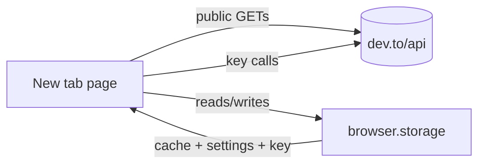

# DEV new tab extension plan

A browser extension that replaces the new tab page with a feed of DEV (dev.to) posts. It's similar to daily.dev, but it only pulls from DEV and doesn't need an account to work.

You get the public feed right away. Adding your DEV API key is optional, and it adds your own feed, reading list, reactions and stats.

Drafted 2026-10-11. API details are in `DOCS/reference/DEV-API.md`.

## Decisions so far

- **Approach B.** The public feed comes first, and the API key features are an optional layer on top.
- **Chrome and Firefox.** One codebase, two builds.
- **Desktop only.** No mobile layout work. The page should still behave in a narrow window.

## Stack

| Piece | Choice | Why |
|---|---|---|
| Extension framework | WXT `0.21.4` | Has file-based entrypoints and a `newtab` entrypoint that writes the manifest override for you. Builds Chrome and Firefox from the same code |
| UI | React `19.3` via `@wxt-dev/module-react` | |
| Storage | `wxt/utils/storage` (built into WXT) | Typed wrapper over `browser.storage`. Used for settings, the API key and the feed cache |
| Icons | `lucide-react` | One icon set for everything |
| Fonts | Geist and Geist Mono, bundled with `@fontsource` | Extension pages shouldn't depend on remote font CDNs |
| Tests | Vitest | For the API client, feed building and cache logic |

Versions are what npm showed on 2026-10-11.

**TypeScript version:** npm's latest is `7.0.2`, the new Go-based compiler. WXT's template pins `~5.9.3`, so that's what the project uses until WXT supports 7.

**Firefox manifest:** WXT builds MV2 for Firefox by default and MV3 for Chrome. I'd keep that default. MV2 grants host permissions at install, so the `dev.to` fetches just work. I'd want to test Firefox MV3's host permission prompt before switching to it.

## How it works



- Every request comes from the new tab page itself. That page runs on the extension's origin and has `host_permissions` for `https://dev.to/*`, so the CORS block on authenticated endpoints shouldn't apply. I'll confirm that with a real key call early in Phase 2, before building anything on top of it.
- No background worker or content script for now. If one turns out to be needed later, it gets added then.
- The feed is cached in `browser.storage.local` with a short TTL, around 10 minutes. Opening a new tab shows the cache instantly and refreshes in the background. That keeps request volume low, which matters because DEV doesn't publish its rate limits.
- The API key lives in `browser.storage.local`, never `sync`, and never gets logged.

## Features

### Phase 1: public feed

- New tab override with a card grid that fills the page
- Feed tabs: **Top today** (`top=1`), **Top this week** (`top=7`), **Rising** (`state=rising`), **Latest** (`/articles/latest`)
- Each card shows the cover image, title, author and avatar, tags, reading time, reactions, comment count and publish date. Clicking it opens the post on dev.to
- A tag filter with your tags stored locally, plus a hidden-tags list. Hidden tags are filtered client-side because DEV ignores `tags_exclude`
- A search box backed by `/articles/search`
- Infinite scroll or a "Load more" button using `page`
- Loading, empty, error and offline states. If a 429 comes back, keep showing the cached results with a Retry button
- Keyboard navigation: `/` focuses search, arrow keys move between cards, `Enter` opens the selected one
- A settings page (WXT `options` entrypoint) for default tab, card density and hidden tags

### Phase 2: optional API key

- Paste a key in settings, and it gets checked with `GET /api/users/me`. The header then shows your avatar
- **My feed** tab built from `GET /api/follows/tags`. DEV only filters one `tag` per request, so this means one request per followed tag, merged on our side. Followed tags replace the local tag list when a key is present
- **Reading list** tab (`GET /api/readinglist`). It's view only, since the API can't add bookmarks
- Reaction buttons on cards (`POST /api/reactions/toggle`), with optimistic UI that rolls back if the request fails
- A small stats panel for your own posts: views, reactions and comments from `/api/analytics/totals` and `/past_day`
- Removing the key clears every cached personal response

### Phase 3: polish and shipping

- Toolbar action that opens the feed, plus an optional setting to stop overriding the new tab (it'd still be reachable from the toolbar)
- Light theme only if you want one. Dark is the default
- `wxt zip` and `wxt zip -b firefox` for store packages
- README, CHANGELOG, LICENSE (Apache 2.0) and store listing text

## File structure

```text
DEV-extension/
├── entrypoints/
│   ├── newtab/            # the feed page (index.html, main.tsx, App.tsx)
│   └── options/           # settings page
├── components/
│   ├── feed/              # FeedGrid, ArticleCard, FeedTabs, LoadMore
│   ├── search/            # SearchBox
│   ├── tags/              # TagFilter, TagChip
│   ├── account/           # KeyForm, UserBadge, StatsPanel
│   └── ui/                # Button, Tabs, Spinner, EmptyState, ErrorState
├── lib/
│   ├── api/               # client.ts (fetch + headers + errors), articles.ts, user.ts, reactions.ts, types.ts
│   ├── cache.ts           # TTL cache over storage.local
│   ├── settings.ts        # typed settings + API key storage items
│   └── app-info.ts        # version read from package.json
├── hooks/                 # useFeed, useSettings, useKeyboardNav
├── styles/                # tokens.css (OKLCH color tokens), base.css
├── public/icon/           # extension icons
├── tests/                 # Vitest tests for lib/
├── DOCS/
├── wxt.config.ts
└── package.json
```

The `api/types.ts` types get written from what the API actually returns, not only from the spec. The spec's `ArticleIndex` schema is missing `comments_count`, for example, even though real responses include it.

## Look

Dark charcoal background with white text and one restrained accent, styled close to Vercel. Cards have a thin border, no shadows and no glow. Cover images are shown at a fixed ratio so the grid doesn't jump. The grid uses the full width of the page.

## Leaving out

- Commenting, bookmarking and notifications. The API doesn't support them, so those buttons open dev.to
- Accounts, sync or any backend of our own
- Other sources besides DEV
- Mobile layouts

## Risks and things to check early

1. **Authenticated calls from the new tab page.** The whole of Phase 2 depends on this, so it's the first thing to prove there.
2. **Rate limits.** They're unknown. The cache and 429 handling are there because of this.
3. **Store review.** Chrome only allows new tab extensions that do a single, clearly stated job. A focused feed should be fine, but the listing has to describe exactly that.
4. **Semantic search** is new on DEV's side. I'm leaving it out of v1 and will test it later.
