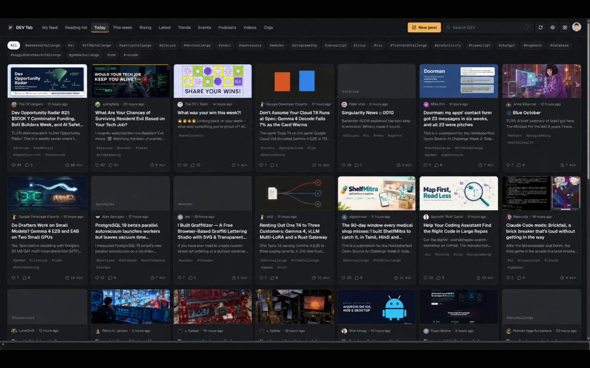
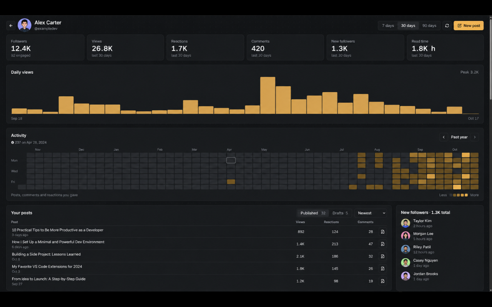

# DEV Tab

DEV Tab replaces your browser's new tab page with a feed of posts from [DEV](https://dev.to). Open a tab, see what people are writing about today, click through to anything that looks good.

I wanted something like daily.dev that only shows DEV, so I made it. It works in Chrome and Firefox and doesn't need an account.





*The dashboard shot uses example data.*

## What it does

- Shows a grid of DEV posts every time you open a new tab
- Switches between **Today**, **This week**, **Rising** and **Latest**
- **Trends**, **Events** (live streams and challenges), **Podcasts** and **Videos** tabs
- **Orgs** tab with posts from the DEV organizations you pick
- Filters by tag. Keep your favorite tags as quick filters, or click any tag on a card
- Hides posts with tags you never want to see
- Searches DEV from the box at the top (press `/` to jump there)
- Arrow keys move between cards and `Enter` opens one
- **Compact** mode drops the cover images if you want more posts on screen
- Caches the feed for 10 minutes, so new tabs open instantly and you still see posts when you're offline
- **New post** button that takes you straight to the DEV editor
- Click the heart on a card to see every reaction count, or the comment count to read the three newest comments

Clicking a post opens it on dev.to. DEV's API doesn't let apps react, comment or bookmark, so those happen on the site.

## Install

DEV Tab is on its way to the Chrome Web Store and Firefox Add-ons. Until it's listed, you can build it and load it yourself.

You'll need Node.js and npm. Grab a copy of this repo, then install the dependencies from its folder:

```bash
npm install
```

### Chrome

```bash
npm run build
```

1. Go to `chrome://extensions` and turn on **Developer mode**.
2. Click **Load unpacked** and pick `.output/chrome-mv3`.
3. Open a new tab. When Chrome asks whether to keep the change, pick **Keep it**.

### Firefox

```bash
npm run build:firefox
```

1. Go to `about:debugging` and click **This Firefox**.
2. Click **Load Temporary Add-on** and pick `manifest.json` in `.output/firefox-mv2`.

Firefox removes temporary add-ons when it restarts, so you'll need to load it again after that. DEV Tab needs Firefox 140 or newer.

## Settings

Click the gear icon in the top right, or open the extension's options from your browser's extensions page.

| Setting | What it does |
|---|---|
| Default feed | Which feed a new tab opens on |
| Card density | Comfortable shows cover images and descriptions. Compact hides them |
| Your tags | The quick filter chips above the feed |
| Hidden tags | Posts with any of these tags never show up |
| Orgs | DEV organizations for the Orgs tab. Add them by username or by pasting any dev.to link |
| DEV API key | Optional. Turns on the account features below |

Changes apply right away, including in tabs you already have open.

## Your DEV account (optional)

Everything above works without an account. If you add a DEV API key in settings, you also get:

- **My feed**, built from the tags you follow on DEV
- **Reading list**, the posts you've saved on DEV (view only, since the API can't save posts)
- **Dashboard**, opened from the grid icon next to your avatar. It shows your follower count, views, reactions, comments and new followers for the last 7, 30 or 90 days, a daily views chart, an activity heatmap you can step back through year by year, your posts and drafts with edit links, recent followers, your top supporters and where your readers came from
- **Smarter search** that finds posts by meaning, not just matching words
- A bookmark on cards for posts already in your reading list

You can create a key under **DEV API Keys** at [dev.to/settings/extensions](https://dev.to/settings/extensions). It stays in this browser's extension storage and only gets sent to `dev.to`. On Firefox, you'll get a prompt asking whether DEV Tab can send it.

## Privacy

DEV Tab has no server, analytics or tracking. Requests go to `dev.to`, and images load from DEV's image servers and YouTube thumbnails. Settings, your API key (if you add one) and cached data live in your browser's extension storage. Removing the key also clears everything that was cached for your account.

The full details are in [PRIVACY.md](PRIVACY.md).

## Development

```bash
npm run dev            # Chrome with live reload
npm run dev:firefox    # Firefox with live reload
npm run compile        # type-check
npm test               # unit tests
npm run zip            # Chrome Web Store zip
npm run zip:firefox    # Firefox Add-ons zips
```

It's built with [WXT](https://wxt.dev), React and TypeScript. `npm run zip:firefox` also makes the sources zip that Firefox Add-ons asks for, since the shipped code is bundled.

## License

Apache 2.0. See [LICENSE](LICENSE).

DEV Tab is an independent project and isn't affiliated with DEV or Forem.

Made with 💖 by [Pink Pixel](https://pinkpixel.dev)
